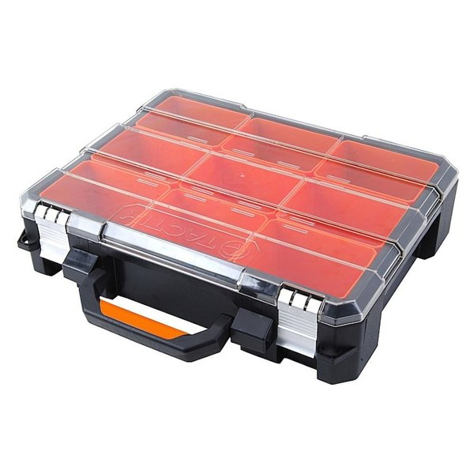

# Tactix Gridfinity Generator



A browser tool that builds 3D-printable [Gridfinity](https://www.youtube.com/watch?v=ra_9zU-mnl8) bins and baseplates sized for the **Tactix 9-compartment organiser**. The same case is also sold as the **R-Van 9-compartment organiser**.

Nothing to install. Open the page, set the size, then download an STL or 3MF.

## ▶ Run it

**Live:** https://disasterofpuppets.github.io/TacTix_Gridfinity_Generator/

## Features

- **Bins** or **baseplates** on the standard 42 mm Gridfinity grid
- **Tactix half / full height presets** (49.37 mm / 94.00 mm, measured floor to rim)
- Every slider has a matching number box. Type a value or drag, and the two stay in sync.
- Options: thin floor, stacking lip, front scoop ramp, label shelf
- Live 3D preview with outside size, usable depth, capacity and PLA weight
- **Download STL** or **3MF**
- **Copy link** shares your exact settings in the URL
- **Save current** keeps up to 12 presets in your browser
- **Clear All** resets everything to the defaults and deletes saved presets, after a confirm prompt

## How to use

1. Pick **Bin** or **Baseplate**.
2. Set **Width** and **Depth** in grid units (1u = 42 mm).
3. Set **Total height**, or tap **Tactix half** / **Tactix full**.
4. Adjust **Wall** and the **Inside** options.
5. Click **Download STL** (or **3MF**) and slice as normal.

Controls in the preview: drag to rotate, right-drag to pan, scroll to zoom, **Recentre** to reset the view.

## Run locally (optional)

The page loads React and Three.js from public CDNs, so you need an internet connection.

1. Clone or download this repo.
2. In the repo folder, run `python -m http.server 8000`.
3. Open http://localhost:8000/

**Copy link when running locally:** the **Copy link** button always shares the GitHub Pages address. To share your own copy instead, open `Tactix Gridfinity Generator.dc.html`, find `SHARE_BASE_URL` in the **USER SETTINGS** block, and change it to your address, keeping the trailing `/`:

```js
const SHARE_BASE_URL = 'http://localhost:8000/';
```

If you forked the repo, use your own Pages address instead: `https://<your-username>.github.io/TacTix_Gridfinity_Generator/`

## Change the defaults

Edit the **USER SETTINGS** block at the top of the `<script>` section in `Tactix Gridfinity Generator.dc.html`. It sets what the page opens with and what **Clear All** resets to.

## Files

| File | Purpose |
|---|---|
| `index.html` | Entry point. Forwards to the generator page. |
| `Tactix Gridfinity Generator.dc.html` | The generator (UI, geometry, export). |
| `support.js` | Page runtime. Generated, do not edit. |
| `assets/` | Organiser images. |

## Credits & licence

- Gridfinity was created by Zack Freedman and is released under the MIT licence.
- This project is released under the [MIT licence](LICENSE).
